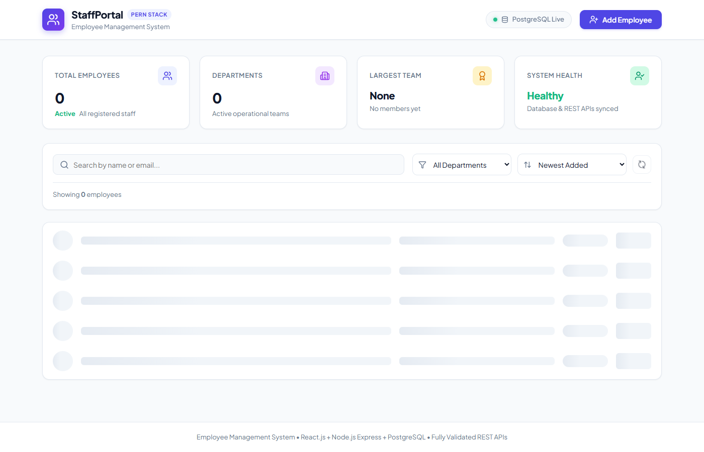

# Employee Management System

A full-stack Employee Management web application built with **React.js**, **Node.js**, **Express.js**, and **PostgreSQL**.



---

## 🚀 Features

- **Employee Management**: View all employees in a clean, responsive table.
- **Add Employee**: Create new employee records with validation.
- **Edit & Delete**: Update existing details or remove employees with confirmation.
- **Search & Filter**: Search employees by name or email, filter by department, and sort columns.
- **Form Validation**: Validates name, email format, unique email, mobile number, department, and designation.
- **Dashboard Metrics**: View total employee counts and department statistics.

---

## 🛠️ Tech Stack

- **Frontend**: React.js, Vite, Lucide Icons, CSS3
- **Backend**: Node.js, Express.js
- **Database**: PostgreSQL
- **Database Client**: `pg` (node-postgres with connection pooling)

---

## 📋 Prerequisites

Before running the project, make sure you have installed:
- [Node.js](https://nodejs.org/) (v18 or higher)
- [PostgreSQL](https://www.postgresql.org/) (Running on port 5432)

---

## ⚙️ Installation & Setup

### 1. Database Setup
Make sure PostgreSQL is running with the password set in your environment (default is `root`).

Run the automated setup script from the root directory to create the database and sample data:
```bash
node scripts/setup-db.js
```

*(Alternatively, you can run `database/schema.sql` and `database/seed.sql` inside PostgreSQL manually).*

---

### 2. Backend Setup
Open a terminal and run:
```bash
cd backend
npm install
npm run dev
```
Backend will start on: **`http://localhost:5000`**

---

### 3. Frontend Setup
Open a second terminal and run:
```bash
cd frontend
npm install
npm run dev
```
Frontend will start on: **`http://localhost:5173`**

Open [http://localhost:5173](http://localhost:5173) in your browser.

---

## 📡 API Endpoints

Base URL: `http://localhost:5000/api`

| Method | Endpoint | Description |
| :--- | :--- | :--- |
| `GET` | `/api/health` | Check server and database health |
| `GET` | `/api/employees` | Get all employees (supports `?search=` and `?department=`) |
| `GET` | `/api/employees/stats` | Get dashboard statistics |
| `GET` | `/api/employees/:id` | Get employee by ID |
| `POST` | `/api/employees` | Add a new employee |
| `PUT` | `/api/employees/:id` | Update an existing employee |
| `DELETE` | `/api/employees/:id` | Delete an employee |

---

## 📁 Project Structure

```
Employee Management System/
├── backend/          # Express API server (controllers, models, routes)
├── frontend/         # React application (Vite)
├── database/         # schema.sql and seed.sql scripts
├── scripts/          # setup-db.js automation script
├── screenshot.png    # Preview screenshot
└── README.md         # Setup documentation
```

---

## 📄 License
This project is open source and available under the [MIT License](LICENSE).
